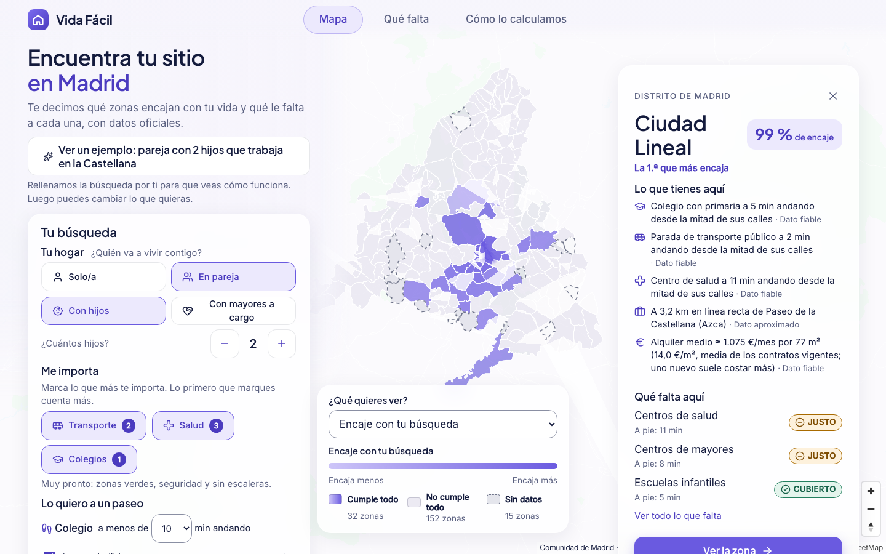

# Vida Fácil · Encuentra tu sitio en Madrid

Quien busca casa en Madrid mira el precio en una web, los colegios en otra y el transporte en otra, y nadie le dice qué zona va con su vida. Un ayuntamiento que quiere saber dónde falta una escuela infantil o un centro de salud tiene los datos sueltos. **Vida Fácil cruza los datos abiertos de la Comunidad de Madrid para enseñarte qué zonas encajan contigo y qué le falta a cada una.**

**Pruébalo:** [vidafacil-madrid.vercel.app](https://vidafacil-madrid.vercel.app)



---

## Qué datos usamos

**26 conjuntos de datos del [Portal de Datos Abiertos de la Comunidad de Madrid](https://datos.comunidad.madrid) en la demo, todos con su control de calidad superado:**
- población, hogares, vivienda, renta y alquiler;
- colegios y sus aulas, centros de salud, servicios para mayores y farmacias, y los hospitales y camas de la región;
- las 6 redes de transporte público del Consorcio Regional de Transportes, que también publica ese portal, y la accesibilidad de las estaciones de metro, Metro Ligero y Cercanías.

El código ya incluye uno más, el valor tasado de la vivienda para comprar (27 en total), que llegará a la demo en su próxima actualización.

→ **[Ficha de cada conjunto, con su enlace, su licencia y para qué lo usamos](data/catalog/datasets/)** (también en la API: `GET /api/v1/datasets?cm_only=true`).

**Los cubrimos todos:** los 179 municipios de la región, y Madrid capital dividida en sus 21 distritos para que no sea un solo bloque.

Como apoyo, sin contarlos como datos de la Comunidad, usamos:
- el padrón y el panel de distritos del Ayuntamiento de Madrid (población y hogares por distrito);
- el mapa de calles y los parques de OpenStreetMap (distancias a pie y zonas verdes);
- el geocodificador oficial CartoCiudad del IGN, solo para colocar los pocos centros que el registro publica sin coordenadas o con coordenadas que contradicen su dirección;
- los catálogos de hospitales (2025) y de centros de atención primaria (2026) del Ministerio de Sanidad, solo para poner nombre a los centros de salud y nombre y camas instaladas a los hospitales del registro de la Comunidad.

## Cómo funciona

1. **Cuéntanos cómo es tu hogar:** quién vive contigo, cuánto puedes pagar de alquiler, dónde trabajas y qué te importa: transporte, salud, colegios, zonas verdes o estaciones sin escaleras.
2. **Mira las zonas que encajan contigo,** con su % de encaje y, debajo, hechos que puedes comprobar, como «colegio con primaria a 5 min andando» o los minutos en transporte público hasta tu trabajo, llegando a las 9:00. Cada hecho dice cuánto nos fiamos del dato.
   - **Comprar:** el código ya usa el valor tasado medio por municipio. En la demo, hasta su próxima actualización, comprar sale «sin datos».
   - **Seguridad:** no la puntuamos, porque no hay un dato oficial que la mida para quien vive en cada zona (D-224 y D-226).
3. **¿Salen pocas?** Te enseñamos cuántas zonas aparecen si cambias una sola cosa, por ejemplo 150 € más al mes o el colegio a 5 minutos más.
4. **Entra en una zona y mira qué le falta:** escuela infantil, colegio, centro de salud, mayores, farmacia y vivienda.
   - No contamos centros: medimos **cuánta capacidad tienes a 15 minutos andando** (aulas, plazas, centros de salud, farmacias), repartida entre todos los vecinos que también la tienen cerca.
   - Cada zona se compara con los demás municipios de su tipo, urbanos o rurales.
   - Los pueblos demasiado pequeños para compararlos solos se comparan junto con sus vecinos más cercanos.
   - Cada fila dice de qué datos sale y a cuántos minutos andando está lo más cercano.

Cómo se calcula cada cosa, con sus límites: pestaña **«Cómo lo calculamos»** de la demo y decisiones D-213 a D-227 en [`docs/00_index/01_decisions_log.md`](docs/00_index/01_decisions_log.md).

## Para agentes de IA (MCP)

Un servidor MCP local deja que un asistente (Claude Desktop, Claude Code u otro cliente MCP) pregunte a Vida Fácil lo mismo que la web y obtenga las mismas cifras y fuentes. Tiene 5 herramientas de solo lectura: buscar zonas, qué falta en una zona, explicar una zona con sus fuentes, encontrar una zona por su nombre y listar las fuentes. Nunca ejecuta SQL. Se arranca con `make mcp` y funciona solo en tu ordenador, contra tu base local; no está desplegado. Uso y configuración: [`docs/04_technical_architecture/32_mcp_server.md`](docs/04_technical_architecture/32_mcp_server.md) (D-225).

## Arráncalo en tu ordenador

Necesitas Docker, [uv](https://docs.astral.sh/uv/) (Python 3.12) y Node 24.

```bash
cp .env.example .env                 # pon una contraseña en POSTGRES_PASSWORD
make dev                             # base de datos + migraciones + catálogo
make ingest-all                      # descarga y valida los datos abiertos, y calcula los indicadores
uv run uvicorn hi_api.main:app --port 8010           # API en http://localhost:8010
npm ci && NEXT_PUBLIC_API_URL=http://localhost:8010 npm run web:dev   # web en http://localhost:3010
```

`make help` lista todos los comandos. `make lint typecheck test` pasa las comprobaciones de calidad.

**Para desarrolladores:**
- `apps/`: la API (FastAPI) y la web (Next.js).
- `packages/`: contratos, dominio y base de datos.
- `services/`: ingesta, cálculo de indicadores y el servidor MCP.
- `data/catalog/`: fuentes, conjuntos de datos, métricas e indicadores.
- `infra/`: Docker, migraciones y despliegue.
- `docs/`: documentación y decisiones.
- `evidence/`: las pruebas de cada control de calidad.

El progreso, fase a fase, está en [`board/BOARD.md`](board/BOARD.md).

## Licencias

- **Código:** [Apache 2.0](LICENSE).
- **Documentación y catálogo de datos:** [CC BY 4.0](docs/LICENSE).
- **Datos de terceros:** cada uno conserva su licencia, recogida en [`data/catalog/sources/`](data/catalog/sources/):
  - Comunidad de Madrid, CC BY 4.0;
  - Consorcio Regional de Transportes de Madrid, licencia de datos abiertos del CRTM («Powered by CRTM»);
  - Ayuntamiento de Madrid, CC BY 4.0;
  - OpenStreetMap, ODbL;
  - CartoCiudad (IGN), CC BY 4.0 scne.es;
  - Ministerio de Sanidad, reutilización autorizada citando la fuente y la fecha de actualización («Catálogo Nacional de Hospitales 2025, actualizado a 31/12/2024» y «Catálogo de Centros de Atención Primaria del SNS 2026, actualizado a 31/12/2025». Ministerio de Sanidad).

## Qué había antes del concurso

Las bases de DATAMAD 2026 permiten partir de trabajo previo si se identifica (§6, «Proyectos preexistentes»). El nuestro está marcado con el tag [`pre-datamad`](../../tree/pre-datamad): commit `cf39459`, del 22 oct de 2026. Incluía la geografía común de la región, los primeros 10 conjuntos de datos y un mapa base.

Todo lo posterior se ha hecho durante el concurso (desde el 7 nov):
- el transporte público (6 redes, con los minutos hasta el trabajo y la accesibilidad de las estaciones) y el resto de conjuntos de datos;
- la lista de lo que falta por zona, con la capacidad al alcance a pie;
- el buscador, con zonas verdes y «sin escaleras»;
- las distancias a pie;
- la web y el despliegue;
- el servidor MCP local.

Al publicar el repositorio, el 11 nov, reescribimos el historial solo para quitar datos de contacto de unos ficheros de prueba. Las fechas de los commits no cambian, y el repositorio original se conserva privado como prueba de fechas ([detalle](evidence/gate-00/2026-11-11/public-repo.md)).

## Equipo

Equipo de una persona: **Mariano**.
